### Full-stack developer · Laravel · React · AI

Hi, I'm Jakub. At work I write PHP (Laravel, Yii2) and Angular, mostly e-contract, recruitment and appointment booking systems. After hours I build things I use myself: a platform for my RPG campaigns, Discord bots for communities I'm in and a searchable archive of a game's lore.

I have a master's in AI from Adam Mickiewicz University. At work I set up Claude and Codex as coding agents and write simple harnesses for them.

Most of my code is in private repos. If you're hiring and want to see some of it, message me and I'll give you access or show it on a call.

## Projects

### The Domed Realms

A platform for running tabletop RPG campaigns, in Polish and English. Live at [thedomedrealms.usermd.net](https://thedomedrealms.usermd.net)

- character sheets with a drag & drop layout and validation while you type, a dice simulator with custom formulas tied to character stats, a world map with pins, guilds with roles and permissions, a wiki, choose-your-path stories
- my own WebSocket server in Node.js with 4 kinds of live rooms: battle map, dungeon, guild scheme and character sheets. Tickets are HMAC-signed, and the GM and the players get separate data
- guild scheme editor: a shared grid map up to 3 km across with walls, doors, textures, drawings and tokens. The browser and the server use the same JS core, and the server checks every change against the user's role
- guild expeditions: a board with each character's fatigue and availability, camp actions, notes and character combos
- dungeon module with an editor and fog of war; the GM can have AI generate a scenario from their own conditions, following my spec, and import it as JSON
- Google and Discord login, 3 themes, about 250 tests (PHPUnit, node:test)

`Laravel 12` `React 18` `Inertia.js` `Node.js` `MySQL` `Tailwind CSS`

  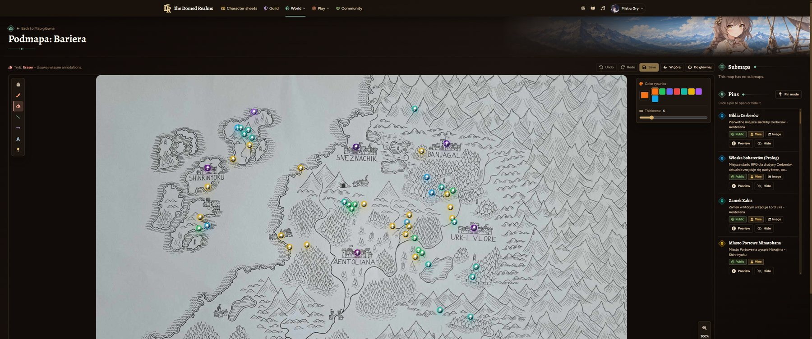
  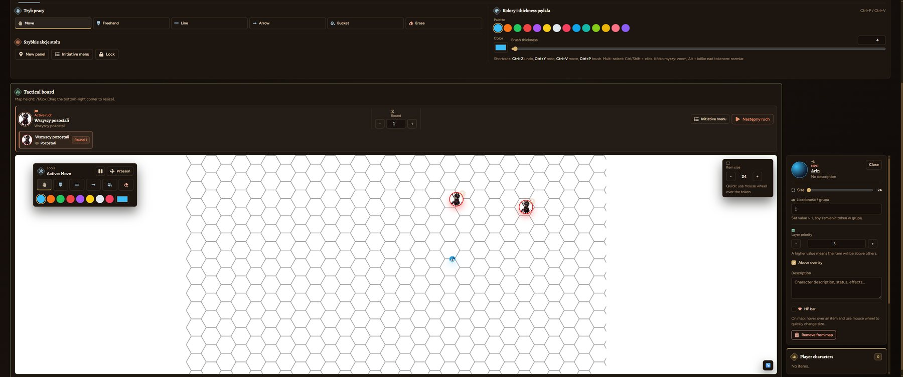

  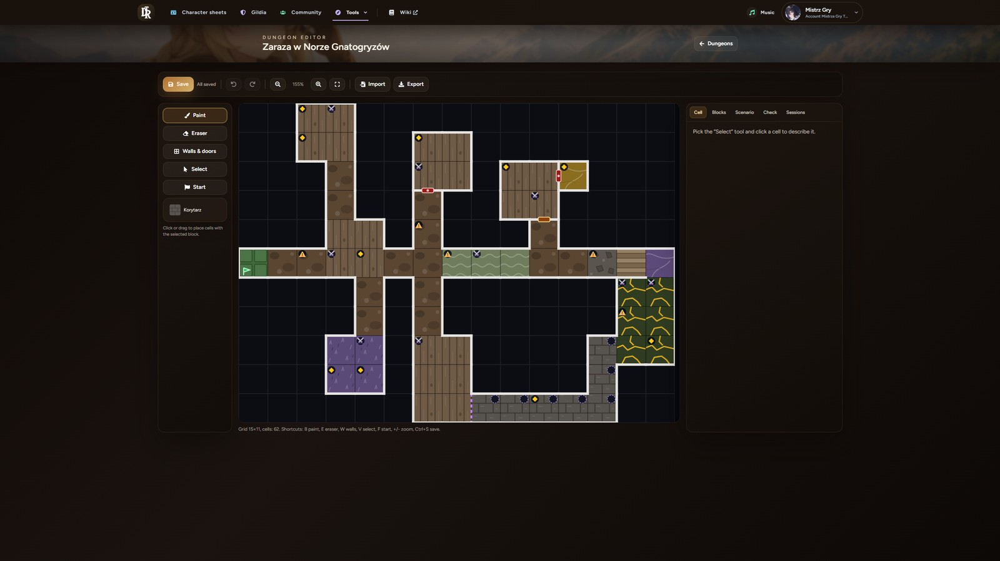
  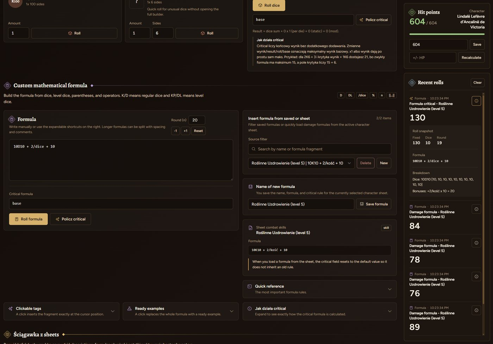

  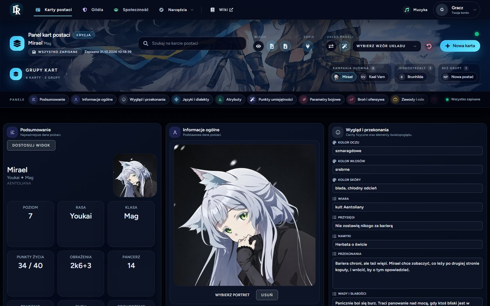

### Discord bots: Kokona, Rosmontis and Si

Bots for running Discord servers. Kokona and Rosmontis are in production. Admin panel: [kokona.thedomedrealms.usermd.net](https://kokona.thedomedrealms.usermd.net)

- Kokona: about 80 commands (moderation, tickets with transcripts, XP levels, economy, gacha, trading between players, giveaways, a slot machine, voice rooms, TTS), Polish and English
- profiles, gacha pulls and slot results are drawn as images: SVG templates rendered to PNG with resvg in a worker thread, with a text fallback if rendering fails
- NovaQ: ranked 5v5 matchmaking for Strinova. Team Elo, team balancing that checks all 126 possible splits, captain votes, map bans and score reports with disputes
- the bot talks to a PHP REST API; every request is HMAC-signed and protected against replay. Trades and giveaway prizes run in one database transaction with locked rows
- Rosmontis: AI chat through Groq and Gemini, with retries, rate limits and knowledge pulled from the game's wiki
- Si: a third bot on the same architecture, for an Arknights: Endfield community. I'm building it spec-first with Claude Code (skills, reviewer subagents, hooks)
- about 140 test files, 46 SQL migrations, my own deploy scripts and a cron watchdog

`Node.js` `TypeScript` `discord.js` `PHP` `MySQL` `resvg` `Groq` `Gemini`

  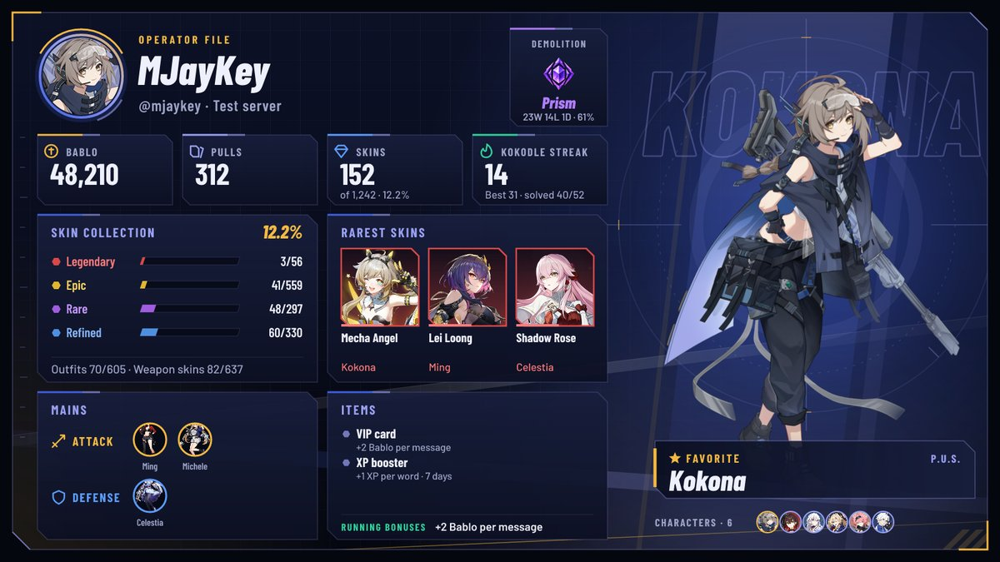
  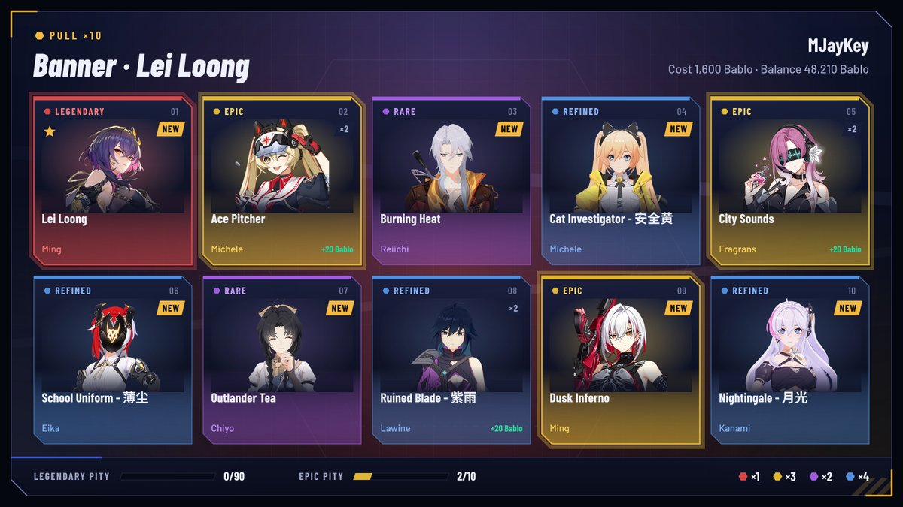

  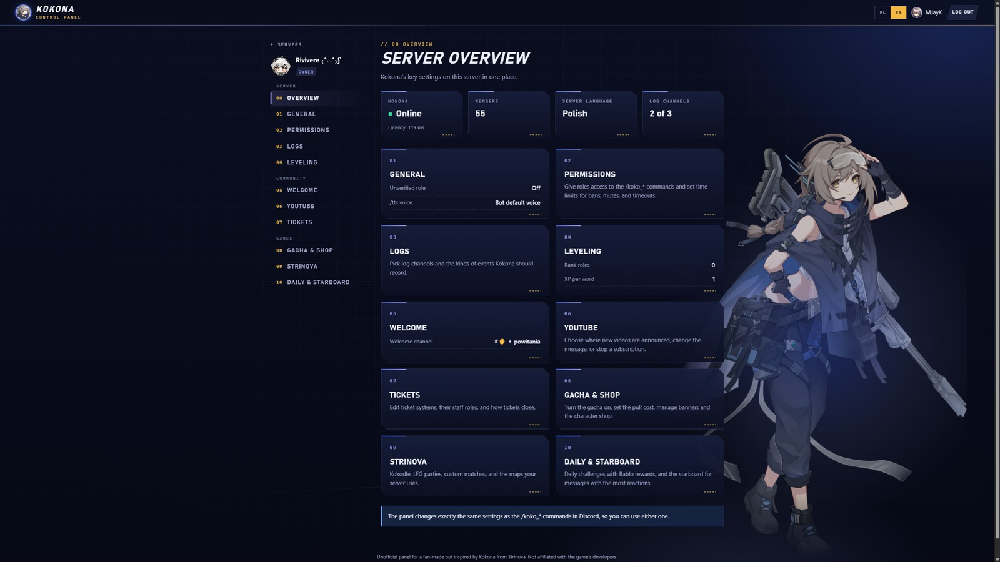
  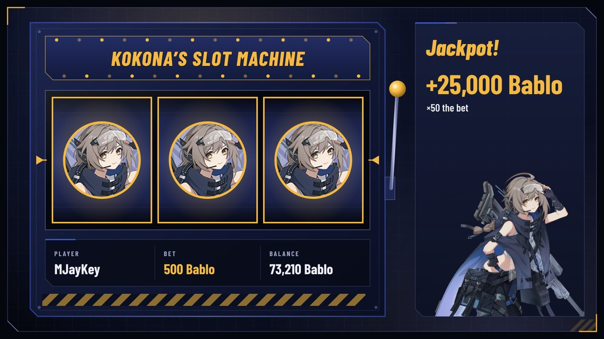

### Strinova Lore

A local, searchable archive of the lore of the game Strinova. Most of the story is spread over Chinese wikis, official accounts in several languages, events and comics, so I built a pipeline to collect it in one place and check every fact against its source.

- Python pipeline: about 3,600 public sources in 4 languages, archived as snapshots with checksums, text extracted with line numbers
- AI agents extracted about 5,200 claims from them. Each claim has a word-for-word quote from the source and a category: confirmed, unverified, inference or theory
- the harness rejects quotes that aren't in the source and enforces the rules (a "confirmed" claim needs an official source, every theory needs its own record), plus JSON Schema validation and tests
- Lore Explorer: a FastAPI app with semantic search (bge-m3 on the GPU), full-text search (SQLite FTS5) and hybrid search, articles for 69 characters, a timeline and machine translations to English

`Python` `FastAPI` `SQLite FTS5` `sentence-transformers` `bge-m3` `Argos Translate`

  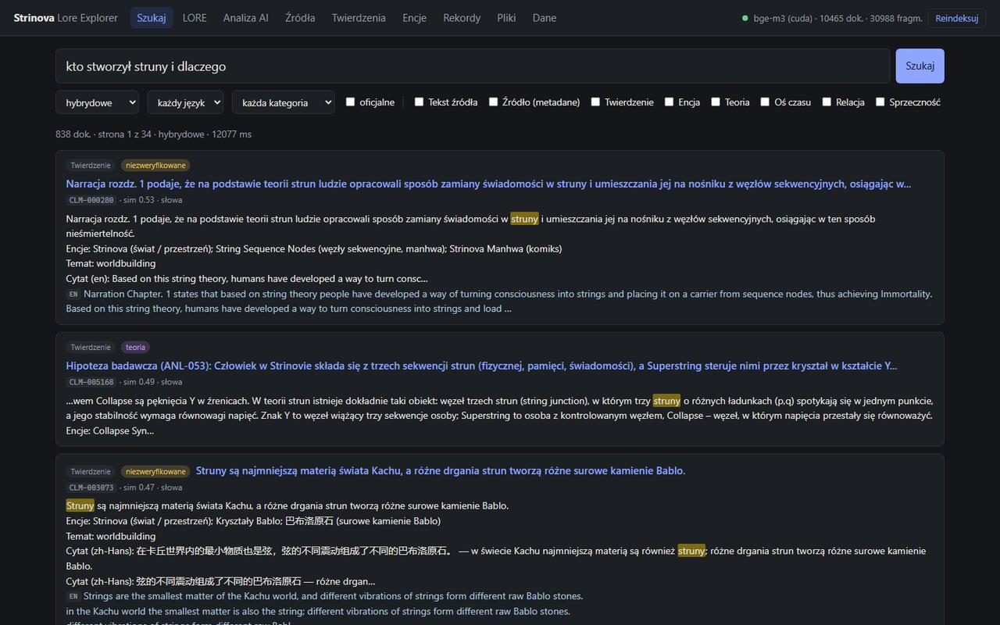
  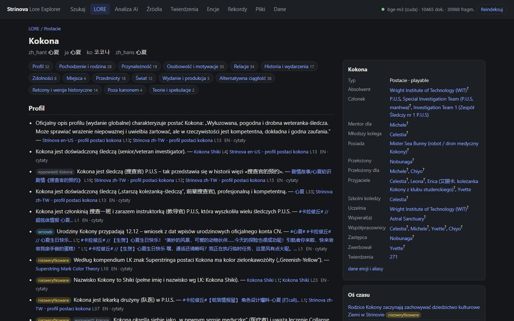

### X Media Downloader

A Chrome extension for downloading videos and GIFs from X. Right-click a video and pick "download as video" or "download as GIF".

- Manifest V3 with a service worker and an offscreen document; it reads the video links from X's own API responses
- when X only serves HLS, it downloads video and audio separately and joins them into one MP4 with my own MP4 code
- GIFs are made in the browser with WebCodecs, nothing goes to outside servers
- React settings page in Polish and English, filename templates, Vitest tests and an end-to-end test in real Chrome

`TypeScript` `React` `Vite` `WebCodecs` `Vitest`

  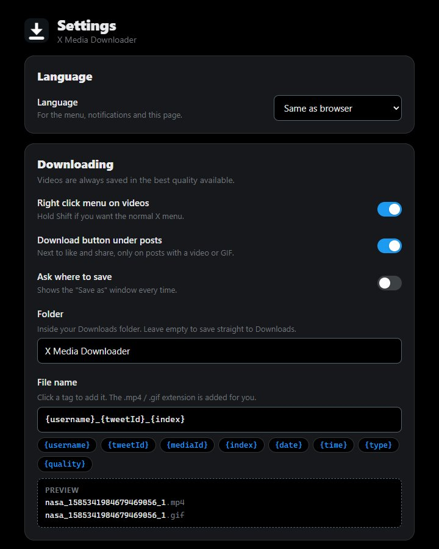

### Marketplace platform (in progress)

A marketplace with social features: listings, profiles with portfolios, a feed and chat. The name and details are confidential for now. On the technical side:

- monorepo (pnpm, Turborepo): Laravel 13 API as a modular monolith with 10 modules, React 19 web app with TanStack Router and Query, Expo mobile app. The API client, Zod schemas, translations and design tokens are shared by web and mobile
- OpenAPI contract (Scramble) and a TypeScript client generated from it (orval); PostgreSQL 18 with UUIDv7 keys, queues on Valkey and Horizon
- sign-in: Sanctum session in the browser, tokens with refresh token rotation in the app (a reused refresh token signs the device out), plus Google, Facebook and Apple
- a feed with posts, comments, visibility settings and reports for moderators; chat and notifications live through Laravel Reverb, and the client polls the API when there is no WebSocket
- photos in private storage behind signed URLs, each re-encoded to WebP without metadata
- 2,100+ tests (Pest on real PostgreSQL, Vitest), Larastan, a Docker Compose environment that mirrors production and starts with one command
- AI agent harness: AGENTS.md, tests that check the docs match the repo, Claude Code hooks that block edits of generated files and require a full check before a session ends, a pre-commit hook

`Laravel 13` `PHP 8.5` `React 19` `TypeScript` `PostgreSQL` `Valkey` `Reverb` `Expo` `Docker`

### Smaller things

- **TierList**: a drag & drop tier list for 282 skins, with data collected by a Python scraper
- **Browser games** in plain JavaScript: a turn-based strategy game and a logic puzzle
- **Training AI models**: fine-tuning LLMs and training LoRAs for image models

## What I use

**Every day:** `PHP` `Laravel` `Yii2` `Angular` `TypeScript` `React` `MySQL`

**Also know well:** `Node.js` `Next.js` `Python` `FastAPI` `PostgreSQL` `Redis` `Docker` `WebSocket`

**AI:** `Claude` `GPT Codex` `Gemini` `Groq` `AI agents` `semantic search` `LLM fine-tuning` `LoRA`

## Outside of code

I run tabletop RPG sessions as a GM and I'm writing my own game system (the rulebook is at 281 pages so far). I also give talks at fan conventions, for example Hikari.

## Contact

[LinkedIn](http://www.linkedin.com/in/jakubzareba-dev) · jakubzareba99@gmail.com
