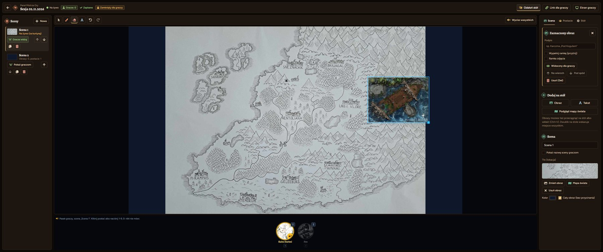
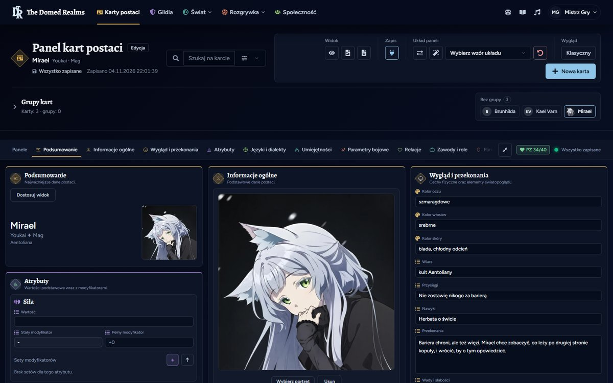
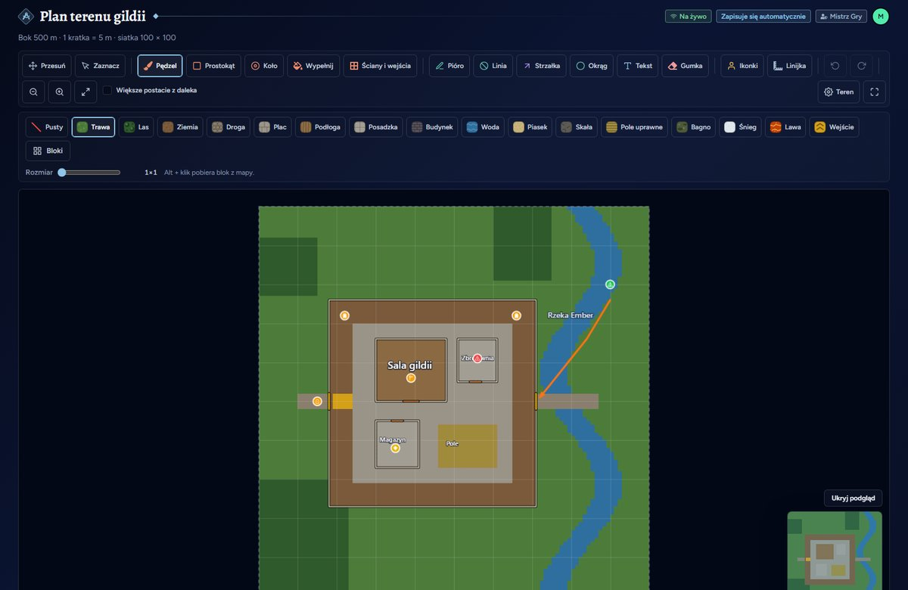

### Full-stack developer · Laravel · React · AI

Hi, I'm Jakub. At work I write PHP (Laravel, Yii2) and Angular, mostly e-contract, recruitment and appointment booking systems. After hours I build things I use myself: a platform for my RPG campaigns, Discord bots for communities I'm in, and a few smaller tools.

I have a master's in AI from Adam Mickiewicz University. At work I set up Claude and Codex as coding agents and write simple harnesses for them.

Most of my code is in private repos. If you're hiring and want to see some of it, message me and I'll give you access or show it on a call.

## Projects

### The Domed Realms

A platform for running tabletop RPG campaigns, in Polish and English. Live at [thedomedrealms.usermd.net](https://thedomedrealms.usermd.net)

Players keep their character sheets here and arrange the panels however they want. There's a dice simulator that reads formulas from character stats, a world map, guilds with permissions, a wiki and choose-your-path stories.

Everything live runs on my own WebSocket server in Node.js: the battle map, dungeons, the guild scheme, character sheets and the GM table. Laravel signs the tickets with HMAC, and players only get the data they're meant to see.

What I added this autumn:

- A GM table. The GM sets up scenes with images, text, drawings and characters, and players watch it live on their own screens or on a TV.
- A guild scheme, which is a shared grid map up to 3 km wide. Several people can draw on it at once and the server checks every change against the user's role.
- Guild expeditions with character fatigue, camp actions and a food and water calculator.
- A new character sheet design. Sheets now save live in small changes, so other open tabs and people you share a sheet with see them right away.
- Dungeons with an editor and fog of war. AI can write a scenario following my spec, and the GM imports it as JSON.

I also set the repo up for Claude Code. One agent plans the work, others do it and check it, and hooks protect secrets and stop two agents from editing the same file.

About 370 tests (PHPUnit, node:test). Google and Discord login, 3 themes.

`Laravel 12` `React 18` `Inertia.js` `Node.js` `MySQL` `Tailwind CSS`

  

  
  

  
  

  
  

The GM table, character sheet and guild scheme screenshots use demo data.

### Discord bots: Kokona, Rosmontis and Si

Bots for running Discord servers. Kokona and Rosmontis are in production, Si is still being built. Admin panel: [kokona.thedomedrealms.usermd.net](https://kokona.thedomedrealms.usermd.net)

Kokona has about 80 commands in Polish and English: moderation, tickets with transcripts, XP levels, economy, gacha, trading between players, giveaways, a slot machine, voice rooms and TTS. Profiles and pull results come out as images. They're SVG templates rendered to PNG with resvg in a worker thread, and if that fails the bot sends plain text.

It also has NovaQ, ranked 5v5 matchmaking for Strinova. It uses team Elo, tries all 126 possible team splits to balance a match, and handles captain votes, map bans and score reports with disputes.

The bot talks to a PHP REST API. Every request is HMAC-signed and protected against replay. Trades and giveaway prizes run in one database transaction with locked rows.

Rosmontis does AI chat through Groq and Gemini and pulls knowledge from the game's wiki. Si runs on the same architecture as Kokona, for an Arknights: Endfield community. I write it with Claude Code, starting from a spec.

About 140 test files, 46 SQL migrations, my own deploy scripts and a cron watchdog.

`Node.js` `TypeScript` `discord.js` `PHP` `MySQL` `resvg` `Groq` `Gemini`

  
  

  
  

### Strinova Lore

A local, searchable archive of the lore of the game Strinova. The story is spread over Chinese wikis, official accounts, events and comics, so I wrote a Python tool that collected about 3,600 public sources in 4 languages.

AI agents pulled about 5,200 claims out of them. Each claim has a word-for-word quote and a category like confirmed, unverified or theory. The harness throws out any quote it can't find in the source, and nothing counts as confirmed without an official source.

I browse it in Lore Explorer, a FastAPI app with semantic search (bge-m3 on the GPU), full-text search (SQLite FTS5), articles for 69 characters and a timeline.

`Python` `FastAPI` `SQLite FTS5` `sentence-transformers` `bge-m3`

  
  

### Rosmontis Assistant

A desktop pet with Rosmontis from Arknights, built in Electron. She walks around the desktop, climbs onto windows and sits on their edges, reminds me about dailies and deadlines, launches programs and rolls RPG dice.

She can also pick up real desktop icons, fly them around and put them back where they were. That goes through Windows APIs from a small C# helper, and if the app crashes, the next start restores the icons from a backup.

Chat goes to the ChatGPT app or to an API (Ollama, LM Studio, OpenAI). It also works as a wallpaper and can export one for Wallpaper Engine. The repo is private because the character art isn't mine.

`Electron` `JavaScript` `Spine` `WebGL` `C#` `PowerShell`

### Chrome extensions

**X Media Downloader** saves videos and GIFs from X with a right-click. When X only serves HLS, it fetches video and audio separately and joins them into an MP4 with my own code. GIFs are made in the browser with WebCodecs.

**YouTube downloader** adds a download option to YouTube's own player menu. The extension talks through Native Messaging to a small Python host that runs yt-dlp and FFmpeg, so there's no open port and nothing running in the background.

`TypeScript` `React` `Vite` `WebCodecs` `Vitest` `Python`

  

### Marketplace platform (in progress)

A marketplace with a social side: listings with applications, profiles with portfolios, a feed, a calendar and chat. The name and details are confidential for now, so I only describe the technical side.

It's a pnpm and Turborepo monorepo. The Laravel 13 API is split into 10 modules and the web app is React 19 with TanStack Router and Query. The TypeScript client is generated from an OpenAPI spec, and chat and notifications go through Laravel Reverb. There's an Expo mobile app too, but it's only a skeleton so far.

Lately I'm working on a portfolio site builder. People build a site from their own photos and publish it at their own address.

2,200+ tests (Pest on real PostgreSQL, Vitest), Larastan, and the whole environment starts with one command in Docker Compose. The repo is set up for AI agents, with AGENTS.md, Claude Code hooks, a pre-commit hook and a check that fails when the docs mention files that don't exist.

`Laravel 13` `React 19` `TypeScript` `PostgreSQL` `Valkey` `Reverb` `Expo` `Docker`

### Smaller things

- **TierList**: a drag & drop tier list for 282 skins, with data collected by a Python scraper
- **Browser games** in plain JavaScript: a turn-based strategy game and a logic puzzle
- **Training AI models**: fine-tuning LLMs and training LoRAs for image models

## What I use

**Every day:** `PHP` `Laravel` `Yii2` `Angular` `TypeScript` `React` `MySQL`

**Also know well:** `Node.js` `Next.js` `Python` `FastAPI` `Electron` `PostgreSQL` `Redis` `Docker` `WebSocket`

**AI:** `Claude` `GPT Codex` `Gemini` `Groq` `AI agents` `semantic search` `LLM fine-tuning` `LoRA`

## Outside of code

I run tabletop RPG sessions as a GM and I'm writing my own game system (the rulebook is at 281 pages so far). I also give talks at fan conventions, for example Hikari.

## Contact

[LinkedIn](http://www.linkedin.com/in/jakubzareba-dev) · jakubzareba99@gmail.com
